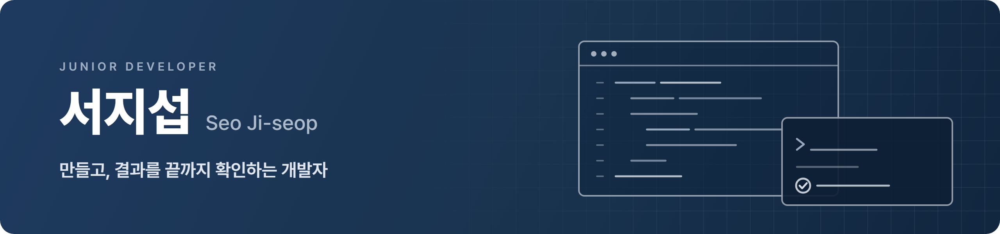
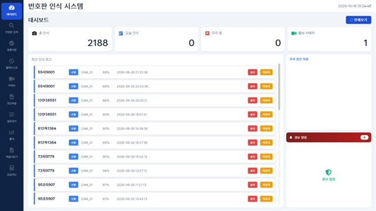
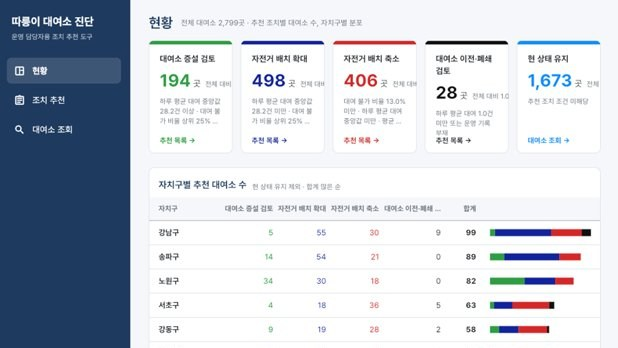
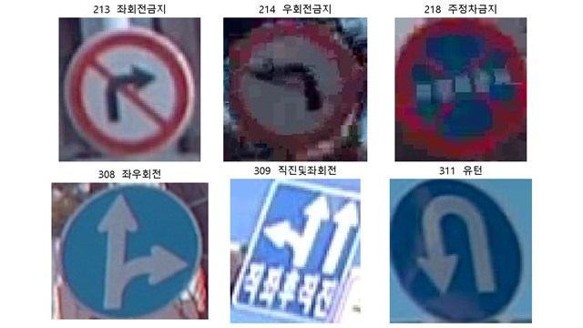
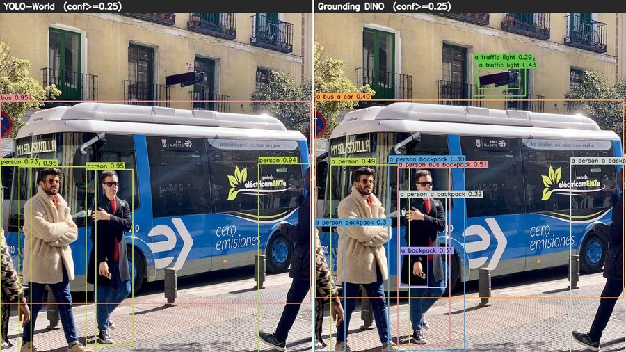
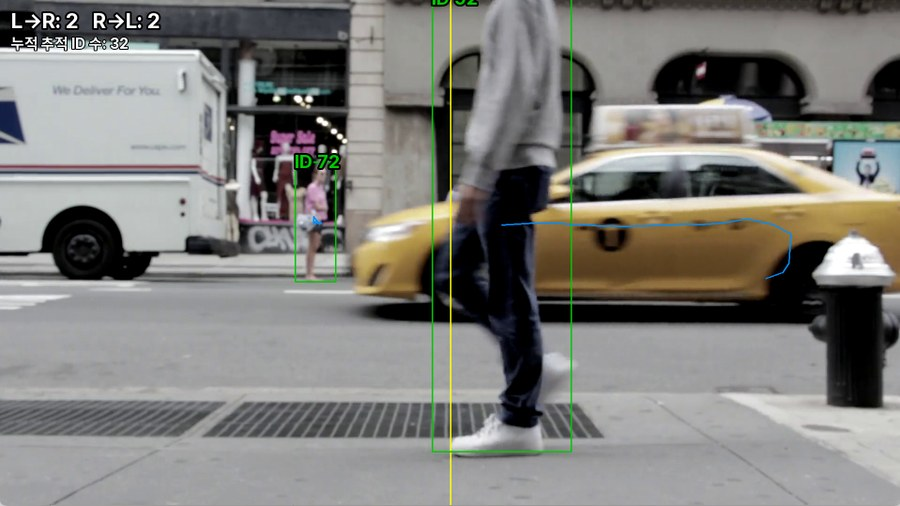
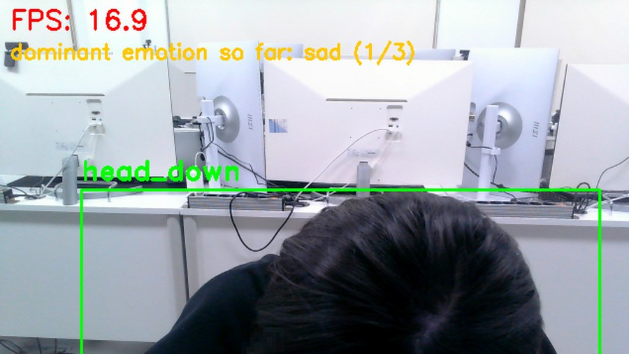

  
  

AI 컴퓨터 비전·웹 서비스·데이터 분석을 직접 만들고, 예상과 다른 결과는 원인을 찾아 끝까지 확인하는 주니어 개발자.

<table>
<tr>
<th width="33%">AI 컴퓨터 비전</th>
<th width="33%">웹 서비스</th>
<th width="33%">데이터 분석</th>
</tr>
<tr>
<td valign="top">검출·인식·추적·합성 모델 적용, 실패 원인을 단계별로 좁혀 모델과 실행 환경 개선</td>
<td valign="top">모델과 데이터를 화면·API로 연결, React·FastAPI·Flask 서비스 구현과 Docker 배포</td>
<td valign="top">공공데이터·쇼핑몰 데이터 수집·정제, SQL 집계, Power BI·Streamlit 대시보드</td>
</tr>
<tr>
<td><a href="https://github.com/Jenny5789/CGI_MOA">MOA</a> · <a href="https://github.com/seo941024/LPR_System">LPR_System</a> · <a href="https://github.com/seo941024/Traffic-Sign-Classification">교통 표지판 분류</a></td>
<td><a href="https://github.com/Jenny5789/CGI_MOA">MOA</a> · <a href="https://github.com/seo941024/Crawling">오카시에리</a> · <a href="https://github.com/seo941024/Web-PRG">펫케어</a></td>
<td><a href="https://github.com/seo941024/DDarueng">공공자전거 대여소 진단</a> · <a href="https://github.com/seo941024/Crawling">오카시에리</a> · <a href="https://github.com/seo941024/LPR_System">LPR_System</a></td>
</tr>
</table>

## 대표 프로젝트

<table>
<tr>
<td width="42%" valign="middle"></td>
<td valign="top">

### [MOA](https://github.com/Jenny5789/CGI_MOA) · 의류 이미지 합성 웹 서비스
4인 팀 프로젝트 · 2026.09 ~ 2026.11 · 기업 연계(미래내일 일경험)

상의 사진과 인물 사진으로 착용 모습을 합성하는 웹 서비스. SAM2로 상의 영역을 지정하고 AnyDoor로 합성.

**결과** GPU 메모리 초과로 분 단위 걸리던 합성 1건을 약 25초로 단축(RTX 3080 10GB), 추가 학습 가중치 비교 후 배포 가중치 선정

**담당** 합성 모델 실행 환경, GPU 메모리 최적화(float16·부품 단위 GPU 적재), AnyDoor 추가 학습 실행·평가(B200), React 합성 화면, 모델 추론 서버 분리·Docker 배포, 코드 검토 · <a href="https://github.com/Jenny5789/CGI_MOA/blob/main/docs/%EC%9E%91%EC%97%85%EC%9D%BC%EC%A7%80_%EC%84%9C%EC%A7%80%EC%84%AD.md">작업일지</a>

      

</td>
</tr>
<tr>
<td valign="top">

### [LPR_System](https://github.com/seo941024/LPR_System) · 번호판 인식 주차 관리
개인 프로젝트

번호판 검출·인식으로 입출차를 기록하고 SQL로 이용 패턴·매출을 분석하는 주차 관리 시스템.

**핵심** 번호판을 거의 읽지 못하던 원인을 검출 단계로 좁혀 YOLO 모델 교체, OCR 2종 비교 후 PaddleOCR 채택, 추론·화면 스레드 분리, 인식 로그와 입출차 이벤트를 나눈 6개 테이블 설계

같은 주제의 첫 프로젝트: <a href="https://github.com/seo941024/ParkingSystem">ParkingSystem</a> · OpenCV 윤곽선·색상 검출과 EasyOCR 인식, Flet 관리 앱

     

</td>
<td width="42%" valign="middle"></td>
</tr>
<tr>
<td width="42%" valign="middle"></td>
<td valign="top">

### [서울 공공자전거 대여소 진단 프로그램](https://github.com/seo941024/DDarueng)
개인 프로젝트

대여 기록과 대여 가능 수량으로 자주 비는 대여소와 자전거가 남는 대여소를 구분하고, 대여소마다 검토할 운영 조치 분류.

**핵심** 공급 부족·과잉 판정 기준 설계, 규칙 기반 분류와 k-means 군집화 비교, DuckDB SQL 분석, Power BI 현황 대시보드와 Flutter 분석 프로그램

    

</td>
</tr>
<tr>
<td valign="top">

### [오카시에리](https://github.com/seo941024/Crawling) · 일본 과자 가격 비교 검색
개인 프로젝트

일본 과자 직구 쇼핑몰 3곳의 상품을 하나의 DB로 모아 검색하고 가격순으로 비교하는 웹사이트.

**핵심** 사이트 구조별 정적·동적 수집 방식 선택, SQLite 통합 DB와 Flask 검색(초성 검색·필터), GitHub Actions 주 1회 자동 수집, 자동 수집 서버 접속 차단 원인을 확인하고 우회 없이 수집 경로 분리

    

</td>
<td width="42%" valign="middle"></td>
</tr>
</table>

## 그 밖의 프로젝트

<table>
<tr>
<td width="33%" valign="top">

 
**[교통 표지판 분류](https://github.com/seo941024/Traffic-Sign-Classification)** 
한국 교통 표지판 10종을 같은 조건의 ANN·DNN·CNN으로 학습해 구조별 성능 비교, PyTorch·Keras 교차 구현

 

</td>
<td width="33%" valign="top">

 
**[PromptScene · 자연어 장면 검색](https://github.com/seo941024/PromptScene)** 
텍스트로 찾을 대상을 지정하는 Open-Vocabulary Detection 모델 비교, 문장 기반 영상·사진첩 장면 검색

 

</td>
<td width="33%" valign="top">

 
**[펫케어 · 반려동물 케어 웹 서비스](https://github.com/seo941024/Web-PRG)** 
초보 반려인을 위한 입양 준비·건강 관리 웹, Node 서버 프록시 기반 공공데이터 API와 카카오 지도 API 연동

 

</td>
</tr>
<tr>
<td width="33%" valign="top">

 
**[EntranceCounter · 출입 인원 카운터](https://github.com/seo941024/EntranceCounter)** 
프레임 간 같은 사람에게 같은 ID를 유지하는 객체 추적, 가상 선 통과 인원 방향별 집계

 

</td>
<td width="33%" valign="top">

 
**[DeskPoseAI · 집중 자세·표정 인식](https://github.com/seo941024/DeskPoseAI)** 
자세 키포인트 기반 책상 앞 자세 3종 분류, 표정 인식 결과 집계 기반 집중 상태 판단

  

</td>
<td width="33%" align="center" valign="middle">

**[전체 저장소 보기 →](https://github.com/seo941024?tab=repositories)** 
학습 기록·실습 저장소 포함

</td>
</tr>
</table>

## 기술 스택

기술 이름을 누르면 해당 기술을 사용한 저장소로 이동.

| 분류 | 기술 |
|---|---|
| Languages | [Python](https://github.com/seo941024/Python) · [SQL](https://github.com/seo941024/DDarueng) · [Java](https://github.com/seo941024/Java) · [JavaScript](https://github.com/seo941024/Web-PRG) · [C++](https://github.com/seo941024/Cpp-CV) · [Dart](https://github.com/seo941024/DDarueng) · [HTML·CSS](https://github.com/seo941024/Web-PRG) |
| AI·컴퓨터 비전 | [PyTorch](https://github.com/seo941024/Traffic-Sign-Classification) · [Keras](https://github.com/seo941024/Traffic-Sign-Classification) · [scikit-learn](https://github.com/seo941024/DeskPoseAI) · [XGBoost](https://github.com/seo941024/DeskPoseAI) · [YOLO](https://github.com/seo941024/LPR_System) · [OpenCV](https://github.com/seo941024/LPR_System) · [PaddleOCR](https://github.com/seo941024/LPR_System) · [EasyOCR](https://github.com/seo941024/ParkingSystem) · [DeepFace](https://github.com/seo941024/DeskPoseAI) · [Hugging Face](https://github.com/seo941024/PromptScene) · [SAM2·AnyDoor](https://github.com/Jenny5789/CGI_MOA) |
| Backend | [FastAPI](https://github.com/Jenny5789/CGI_MOA) · [Flask](https://github.com/seo941024/Crawling) · [SQLAlchemy](https://github.com/Jenny5789/CGI_MOA) · [Node.js](https://github.com/seo941024/Web-PRG) · [Spring MVC](https://github.com/seo941024/Java) · [MyBatis](https://github.com/seo941024/Java) · [Servlet·JSP](https://github.com/seo941024/Java) |
| Frontend·앱 | [React](https://github.com/Jenny5789/CGI_MOA) · [Vite](https://github.com/Jenny5789/CGI_MOA) · [Streamlit](https://github.com/seo941024/LPR_System) · [Flutter](https://github.com/seo941024/DDarueng) · [PyQt6](https://github.com/seo941024/LPR_System) · [Flet](https://github.com/seo941024/Python) · [MFC](https://github.com/seo941024/Cpp-CV) |
| Data | [pandas](https://github.com/seo941024/DDarueng) · [NumPy](https://github.com/seo941024/Traffic-Sign-Classification) · [Matplotlib](https://github.com/seo941024/Traffic-Sign-Classification) · [Plotly](https://github.com/seo941024/LPR_System) · [Power BI](https://github.com/seo941024/DDarueng) · [Selenium](https://github.com/seo941024/Crawling) · [BeautifulSoup](https://github.com/seo941024/Crawling) |
| DB | [SQLite](https://github.com/seo941024/Crawling) · [DuckDB](https://github.com/seo941024/DDarueng) · [MySQL](https://github.com/Jenny5789/CGI_MOA) · [Oracle](https://github.com/seo941024/Java) |
| DevOps·도구 | [Git·PR 협업](https://github.com/Jenny5789/CGI_MOA) · [Docker](https://github.com/Jenny5789/CGI_MOA) · [GitHub Actions](https://github.com/seo941024/Crawling) · [Cloudflare Tunnel](https://github.com/Jenny5789/CGI_MOA) |

## 학습 기록

언어 문법, 자료구조와 알고리즘, 웹·데스크톱 프레임워크 학습과 응용 결과물.

| 저장소 | 학습 | 응용 |
|---|---|---|
| [Python · 자료구조와 알고리즘](https://github.com/seo941024/Python) | 배열·연결 방식 자료구조 클래스 구현, 정렬 6종, 미로 탐색 3종 비교 | 수식 계산기, 라인 편집기, Flet 미로 탐색 시각화 |
| [Java · 기본 문법과 웹 애플리케이션](https://github.com/seo941024/Java) | 문법·객체지향·컬렉션, 서블릿·JSP MVC, Spring MVC·MyBatis 계층 분리 | 세션 로그인 기반 회원 관리 웹 애플리케이션 |
| [Cpp-CV · C++와 컴퓨터 비전](https://github.com/seo941024/Cpp-CV) | C++ 클래스·포인터·동적 메모리, OpenCV 화소 처리·특징점 매칭, 딥러닝 분류·검출·추적 | 별도 스레드 추론 기반 MFC 웹캠 뷰어 |
| [Web-PRG · 웹 프로그래밍](https://github.com/seo941024/Web-PRG) | HTML 태그·폼, CSS Flexbox·Grid·반응형, JavaScript DOM·이벤트·localStorage | 자정 자동 초기화·터치 드래그 순서 변경 루틴 관리 웹 앱 |
| [DL_project · 모델 학습과 웹 서비스](https://github.com/seo941024/DL_project) | scikit-learn 분류 모델 학습·평가 | Flask 예측 화면, Docker 실행 환경 |
