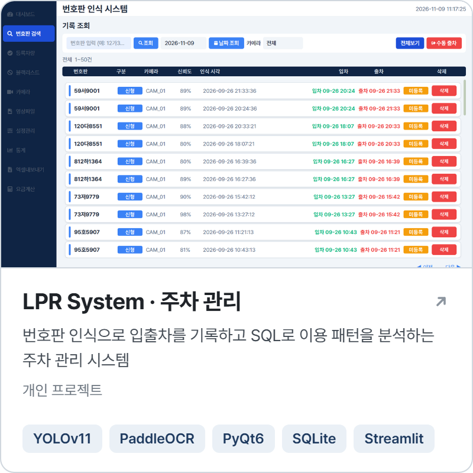
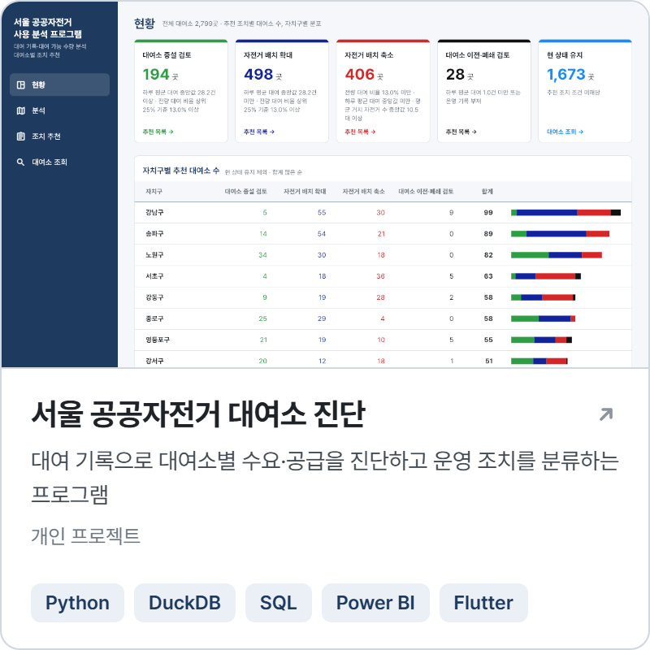
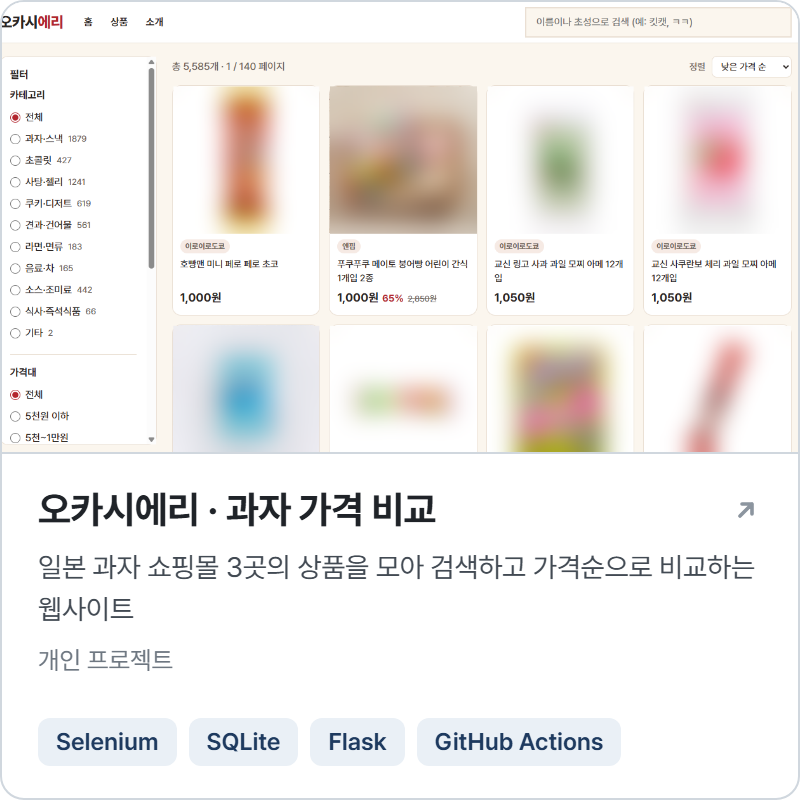
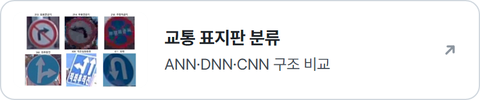
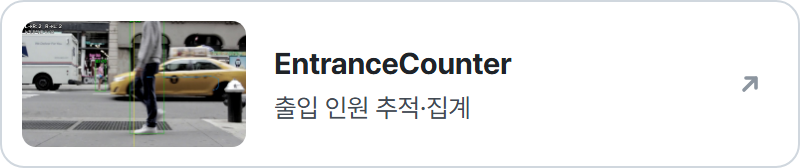
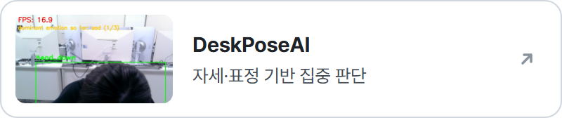

  
  

## 대표 프로젝트

<a href="https://github.com/Jenny5789/CGI_MOA"><picture><source media="(prefers-color-scheme: dark)" srcset="images/cards/moa-dark.png"></picture></a>&nbsp;&nbsp;&nbsp;&nbsp;<a href="https://github.com/seo941024/LPR_System"><picture><source media="(prefers-color-scheme: dark)" srcset="images/cards/lpr-dark.png"></picture></a>

<a href="https://github.com/seo941024/DDarueng"><picture><source media="(prefers-color-scheme: dark)" srcset="images/cards/ddareungi-dark.png"></picture></a>&nbsp;&nbsp;&nbsp;&nbsp;<a href="https://github.com/seo941024/Crawling"><picture><source media="(prefers-color-scheme: dark)" srcset="images/cards/okashieri-dark.png"></picture></a>

## 그 밖의 프로젝트

<a href="https://github.com/seo941024/Traffic-Sign-Classification"><picture><source media="(prefers-color-scheme: dark)" srcset="images/cards/traffic-sign-dark.png"></picture></a>&nbsp;&nbsp;&nbsp;&nbsp;<a href="https://github.com/seo941024/PromptScene"><picture><source media="(prefers-color-scheme: dark)" srcset="images/cards/promptscene-dark.png"></picture></a>

<a href="https://github.com/seo941024/Web-PRG"><picture><source media="(prefers-color-scheme: dark)" srcset="images/cards/petcare-dark.png"></picture></a>&nbsp;&nbsp;&nbsp;&nbsp;<a href="https://github.com/seo941024/EntranceCounter"><picture><source media="(prefers-color-scheme: dark)" srcset="images/cards/entrance-counter-dark.png"></picture></a>

<a href="https://github.com/seo941024/DeskPoseAI"><picture><source media="(prefers-color-scheme: dark)" srcset="images/cards/deskpose-dark.png"></picture></a>&nbsp;&nbsp;&nbsp;&nbsp;<a href="https://github.com/seo941024?tab=repositories"><picture><source media="(prefers-color-scheme: dark)" srcset="images/cards/all-repos-dark.png"></picture></a>

## 기술 스택

<picture>
  <source media="(prefers-color-scheme: dark)" srcset="https://skillicons.dev/icons?i=py,java,js,cpp,dart,html,css,pytorch,tensorflow,sklearn,opencv,fastapi,flask,nodejs,spring,react,vite,flutter,mysql,sqlite,docker,githubactions,git,cloudflare&perline=12&theme=dark">
  
</picture>

<b>기술별 사용 저장소 보기</b>

 

기술 이름을 누르면 해당 기술을 사용한 저장소로 이동.

| 분류 | 기술 |
|---|---|
| Languages | [Python](https://github.com/seo941024/Python) · [SQL](https://github.com/seo941024/DDarueng) · [Java](https://github.com/seo941024/Java) · [JavaScript](https://github.com/seo941024/Web-PRG) · [C++](https://github.com/seo941024/Cpp-CV) · [Dart](https://github.com/seo941024/DDarueng) · [HTML·CSS](https://github.com/seo941024/Web-PRG) |
| AI | [PyTorch](https://github.com/seo941024/Traffic-Sign-Classification) · [Keras](https://github.com/seo941024/Traffic-Sign-Classification) · [scikit-learn](https://github.com/seo941024/DeskPoseAI) · [XGBoost](https://github.com/seo941024/DeskPoseAI) · [YOLO](https://github.com/seo941024/LPR_System) · [OpenCV](https://github.com/seo941024/LPR_System) · [PaddleOCR](https://github.com/seo941024/LPR_System) · [EasyOCR](https://github.com/seo941024/ParkingSystem) · [DeepFace](https://github.com/seo941024/DeskPoseAI) · [Hugging Face](https://github.com/seo941024/PromptScene) · [SAM2·AnyDoor](https://github.com/Jenny5789/CGI_MOA) |
| Backend | [FastAPI](https://github.com/Jenny5789/CGI_MOA) · [Flask](https://github.com/seo941024/Crawling) · [SQLAlchemy](https://github.com/Jenny5789/CGI_MOA) · [Node.js](https://github.com/seo941024/Web-PRG) · [Spring MVC](https://github.com/seo941024/Java) · [MyBatis](https://github.com/seo941024/Java) · [Servlet·JSP](https://github.com/seo941024/Java) |
| Frontend·앱 | [React](https://github.com/Jenny5789/CGI_MOA) · [Vite](https://github.com/Jenny5789/CGI_MOA) · [Streamlit](https://github.com/seo941024/LPR_System) · [Flutter](https://github.com/seo941024/DDarueng) · [PyQt6](https://github.com/seo941024/LPR_System) · [Flet](https://github.com/seo941024/Python) · [MFC](https://github.com/seo941024/Cpp-CV) |
| Data | [pandas](https://github.com/seo941024/DDarueng) · [NumPy](https://github.com/seo941024/Traffic-Sign-Classification) · [Matplotlib](https://github.com/seo941024/Traffic-Sign-Classification) · [Plotly](https://github.com/seo941024/LPR_System) · [Power BI](https://github.com/seo941024/DDarueng) · [Selenium](https://github.com/seo941024/Crawling) · [BeautifulSoup](https://github.com/seo941024/Crawling) |
| DB | [SQLite](https://github.com/seo941024/Crawling) · [DuckDB](https://github.com/seo941024/DDarueng) · [MySQL](https://github.com/Jenny5789/CGI_MOA) · [Oracle](https://github.com/seo941024/Java) |
| DevOps·도구 | [Git·PR 협업](https://github.com/Jenny5789/CGI_MOA) · [Docker](https://github.com/Jenny5789/CGI_MOA) · [GitHub Actions](https://github.com/seo941024/Crawling) · [Cloudflare Tunnel](https://github.com/Jenny5789/CGI_MOA) |

## 학습 기록

<b>저장소 5개</b> · 언어 문법, 자료구조와 알고리즘, 웹·데스크톱 프레임워크 학습과 응용 결과물.

 

| 저장소 | 학습 | 응용 |
|---|---|---|
| [Python · 자료구조와 알고리즘](https://github.com/seo941024/Python) | 배열·연결 방식 자료구조 클래스 구현, 정렬 6종, 미로 탐색 3종 비교 | 수식 계산기, 라인 편집기, Flet 미로 탐색 시각화 |
| [Java · 기본 문법과 웹 애플리케이션](https://github.com/seo941024/Java) | 문법·객체지향·컬렉션, 서블릿·JSP MVC, Spring MVC·MyBatis 계층 분리 | 세션 로그인 기반 회원 관리 웹 애플리케이션 |
| [Cpp-CV · C++와 컴퓨터 비전](https://github.com/seo941024/Cpp-CV) | C++ 클래스·포인터·동적 메모리, OpenCV 화소 처리·특징점 매칭, 딥러닝 분류·검출·추적 | 별도 스레드 추론 기반 MFC 웹캠 뷰어 |
| [Web-PRG · 웹 프로그래밍](https://github.com/seo941024/Web-PRG) | HTML 태그·폼, CSS Flexbox·Grid·반응형, JavaScript DOM·이벤트·localStorage | 자정 자동 초기화·터치 드래그 순서 변경 루틴 관리 웹 앱 |
| [DL_project · 모델 학습과 웹 서비스](https://github.com/seo941024/DL_project) | scikit-learn 분류 모델 학습·평가 | Flask 예측 화면, Docker 실행 환경 |

