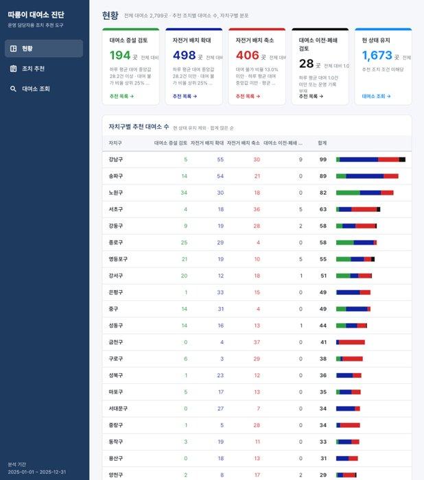
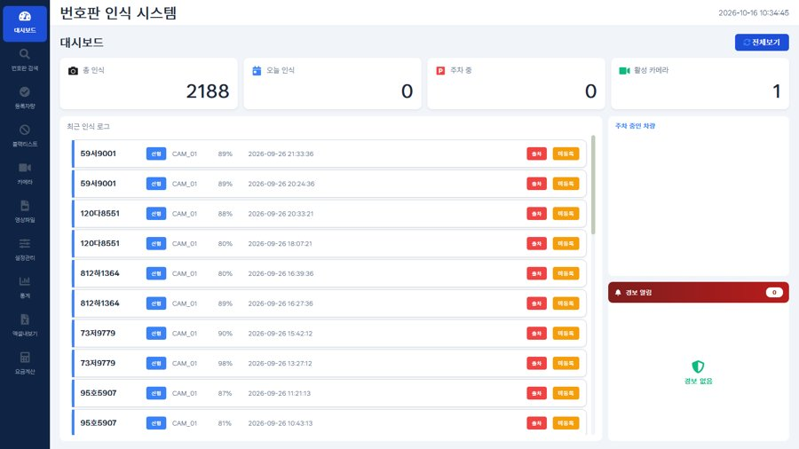
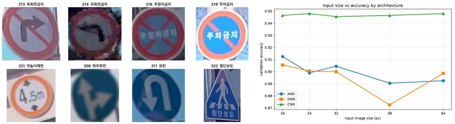
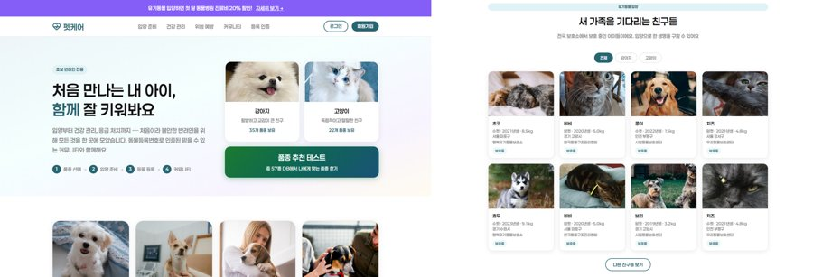

# 서지섭

웹·데스크톱·앱 서비스 구현부터 AI 모델 활용, 데이터 수집·분석까지 만들고 확인하는 개발자.
예상과 다른 결과가 나오면 원인을 찾아 끝까지 해결합니다.

---

## Tech Stack

배지를 누르면 해당 기술을 사용한 저장소로 이동.

| Category | Stack |
|---|---|
| Languages |         |
| Backend |        |
| Web Frontend |    |
| Desktop & Mobile |     |
| Machine Learning |      |
| Computer Vision |    |
| Data |        |
| DB |      |
| DevOps & Tools |     |

---

## 프로젝트

### 대표 프로젝트

<table>
<tr>
<td width="210" align="center"></td>
<td>

**[서울 공공자전거 대여소 진단 프로그램](https://github.com/seo941024/DDarueng)** · 개인 프로젝트 
서울시 공공자전거 대여 기록과 대여 가능 수량 기반 대여소별 수요·공급 상태 진단 
공급 부족·과잉 판정 기준 설계, 규칙 기반 분류와 k-means 군집화 비교

`Python` `DuckDB` `SQL` `Flutter` `Power BI`

</td>
</tr>
<tr>
<td align="center"></td>
<td>

**[오카시에리](https://github.com/seo941024/Crawling)** · 개인 프로젝트 
일본 과자 직구 쇼핑몰 3곳의 상품을 모아 가격을 비교하는 검색 서비스 
사이트 구조별 정적·동적 수집 방식 선택, SQLite DB와 Flask 통합 검색, 주 1회 자동 수집

`Python` `requests` `Selenium` `SQLite` `Flask` `JavaScript`

</td>
</tr>
<tr>
<td align="center"></td>
<td>

**[LPR_System · 번호판 인식 주차 관리](https://github.com/seo941024/LPR_System)** · 개인 프로젝트 
번호판 검출·인식으로 입출차를 기록하고 SQL로 이용 패턴을 분석하는 주차 관리 시스템 
YOLO 번호판 검출 학습, OCR 2종 비교 후 PaddleOCR 채택, SQLite 입출차 기록 분석 대시보드

`Python` `PyTorch` `YOLO` `PaddleOCR` `PyQt6` `SQLite` `Streamlit`

</td>
</tr>
<tr>
<td align="center"></td>
<td>

**[MOA · 의류 이미지 합성 웹 서비스](https://github.com/Jenny5789/CGI_MOA)** · 4인 팀 프로젝트 
미래내일 일경험 참여, 상의·인물 사진 기반 시착 이미지 합성 
담당: React 단계별 합성 화면 구현, FastAPI 서버 API 연동, 브랜치·PR 기반 팀 협업

`React` `FastAPI` `MySQL` `PyTorch` `Cloudflare`

</td>
</tr>
<tr>
<td align="center"></td>
<td>

**[교통 표지판 분류](https://github.com/seo941024/Traffic-Sign-Classification)** · 개인 프로젝트 
한국 교통 표지판 10종을 같은 조건의 ANN·DNN·CNN으로 학습해 구조별 성능 비교 
PyTorch 학습 루프 구현, Keras 이중 구현 교차 확인, 입력 크기 반증 실험

`PyTorch` `Keras`

</td>
</tr>
<tr>
<td align="center"></td>
<td>

**[펫케어 · 반려동물 케어 웹 서비스](https://github.com/seo941024/Web-PRG)** · 개인 프로젝트 
초보 반려인을 위한 입양 준비·건강 관리·위험 예방 통합 웹 
Node 서버 프록시 기반 공공데이터포털 유기동물 API 연동, 카카오 지도 API, 품종 추천 퀴즈

`HTML` `CSS` `JavaScript` `Node.js`

</td>
</tr>
<tr>
<td align="center"></td>
<td>

**[별님앱 · 게임 플레이어용 계산기·기록 웹앱](https://byeolnim.vercel.app)** · 개인 프로젝트 · 비공개 저장소 · [byeolnim.vercel.app](https://byeolnim.vercel.app) 
메이플스토리 GMS 플레이어를 위한 계산기·시뮬레이터·기록 도구 모음, 홈 화면 설치 가능한 PWA 
Vercel 서버리스 함수와 Upstash Redis 기반 계정·게시판·경험치 기록, Web Push 보스 일정 알림

`JavaScript` `Vercel` `Redis` `PWA` `Web Push`

</td>
</tr>
<tr>
<td align="center"></td>
<td>

**해골용사 · 로그라이트 액션 웹 게임** · 개인 프로젝트 · 비공개 저장소 
해골로 되살아난 용사가 월드 10개를 지나 마왕에게 다시 도전하는 사이드스크롤 로그라이트 
직업 8종·보스 10종·유물 시너지, Web Audio API 효과음·BGM 합성, V2에서 엔진·장면·데이터 분리 재작성

`JavaScript` `Canvas 2D` `Web Audio API`

</td>
</tr>
</table>

### 기타 프로젝트

<table>
<tr>
<td>

**[PromptScene · 자연어 장면 검색](https://github.com/seo941024/PromptScene)** 
텍스트로 찾을 대상을 지정하는 Open-Vocabulary Detection 모델 비교, 문장 기반 영상·사진첩 장면 검색

`Python` `YOLO-World` `Grounding DINO`

</td>
</tr>
<tr>
<td>

**[EntranceCounter · 출입 인원 카운터](https://github.com/seo941024/EntranceCounter)** 
프레임 간 같은 사람에게 같은 ID를 유지하는 객체 추적, 가상 선 통과 인원 방향별 집계

`Python` `YOLO` `BoT-SORT`

</td>
</tr>
<tr>
<td>

**[DeskPoseAI · 집중 자세·표정 인식](https://github.com/seo941024/DeskPoseAI)** 
자세 키포인트 기반 책상 앞 자세 3종 분류, 표정 인식 결과 집계 기반 집중 상태 판단

`Python` `YOLO-Pose` `XGBoost` `DeepFace`

</td>
</tr>
</table>

---

## 학습 기록

언어 문법, 자료구조와 알고리즘, 웹·데스크톱 프레임워크 학습과 응용 결과물.

<table>
<tr>
<td>

**[Python · 자료구조와 알고리즘](https://github.com/seo941024/Python)** 
학습: 배열·연결 방식 자료구조 클래스 구현, 정렬 6종, 미로 탐색 3종 비교 
응용: 수식 계산기, 라인 편집기, Flet 미로 탐색 시각화, tkinter 화면 구성

`Python` `Flet` `tkinter`

</td>
</tr>
<tr>
<td>

**[Java · 기본 문법과 웹 애플리케이션](https://github.com/seo941024/Java)** 
학습: 문법·객체지향·컬렉션, 서블릿·JSP MVC 패턴, Spring MVC·MyBatis 계층 분리 
응용: 세션 로그인 기반 회원 관리 웹 애플리케이션

`Java` `Servlet/JSP` `Spring MVC` `MyBatis` `Oracle`

</td>
</tr>
<tr>
<td>

**[Cpp-CV · C++와 컴퓨터 비전](https://github.com/seo941024/Cpp-CV)** 
학습: C++ 클래스·포인터·동적 메모리, OpenCV 화소 처리·특징점 매칭, 딥러닝 분류·검출·추적 
응용: 별도 스레드 추론 기반 MFC 웹캠 뷰어

`C++` `MFC` `OpenCV`

</td>
</tr>
<tr>
<td>

**[Web-PRG · 웹 프로그래밍](https://github.com/seo941024/Web-PRG)** 
학습: HTML 태그·폼, CSS 박스 모델·Flexbox·Grid·반응형, JavaScript DOM·이벤트·localStorage 
응용: 파스텔 루틴 투두리스트, 한국 시간 자정 자동 초기화·터치 드래그 순서 변경 루틴 관리 웹 앱

`HTML` `CSS` `JavaScript`

</td>
</tr>
</table>

---

## GitHub Stats

 

---

## Contact
- Email: seo941024@gmail.com
