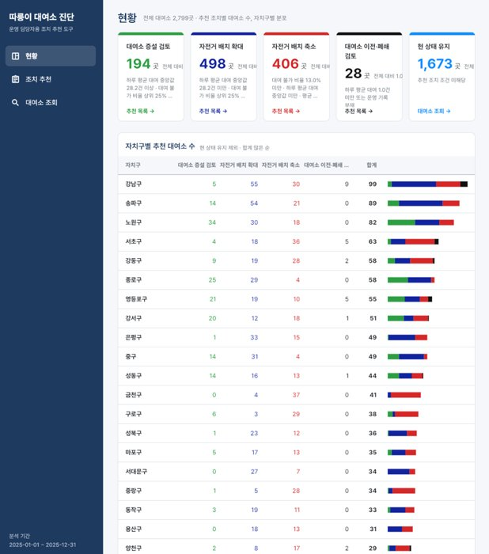
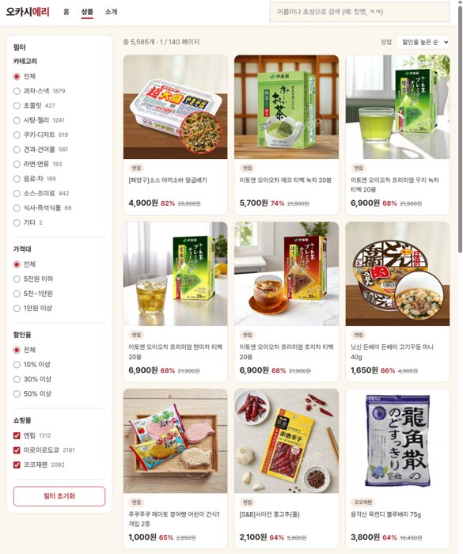
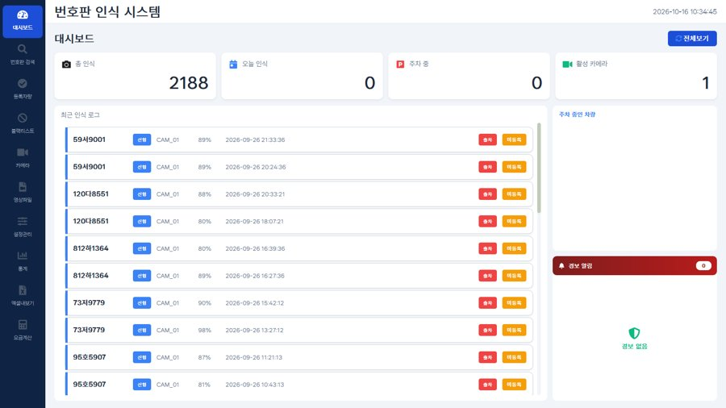
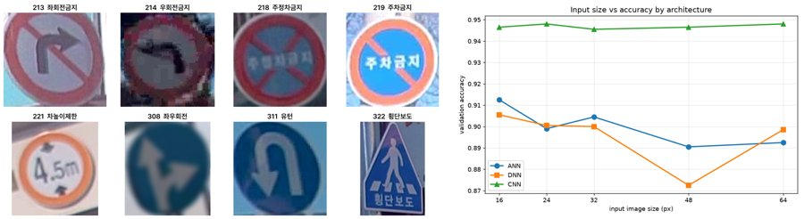
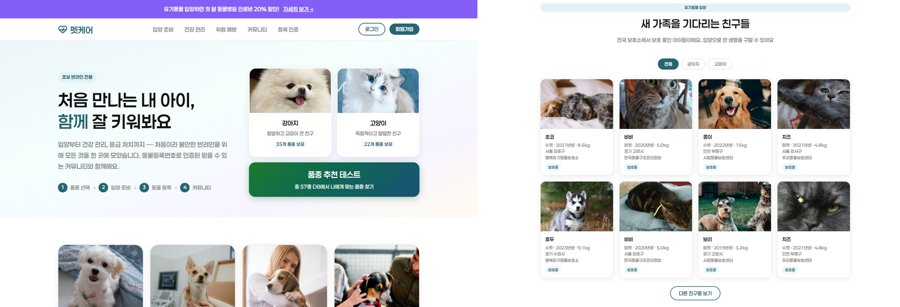
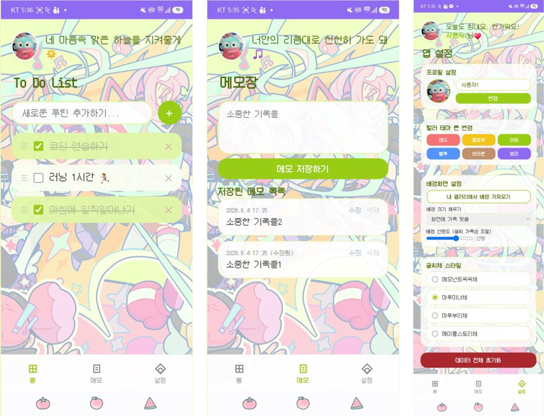
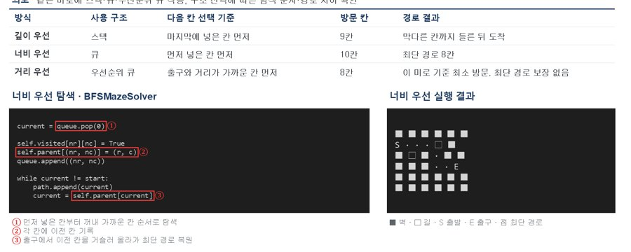
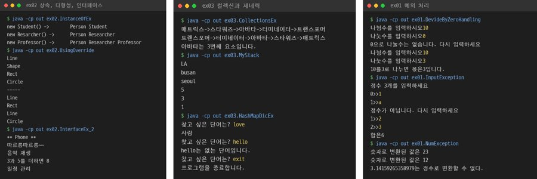
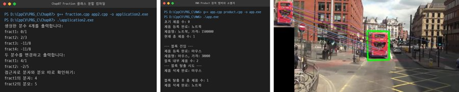

# 서지섭

데이터 수집·정제·분석부터 AI 모델 학습과 활용, 웹·데스크톱·앱 서비스 구현까지 만들고 검증하는 개발자.
문제의 원인을 실측으로 확인하고, 근거를 남기며 해결하는 방식으로 작업합니다.

---

## Tech Stack

---

## 대표 프로젝트

<table>
<tr>
<td width="38%"></td>
<td>

### [서울 공공자전거 대여소 진단 프로그램](https://github.com/seo941024/DDarueng)
대여 기록 3,737만 건·대여 가능 수량 2,418만 행 기반 대여소별 수요·공급 상태 진단

- 대여소별 공급 부족·과잉 판정 기준 설계, 운영 조치 추천 데스크톱 프로그램
- 운영 기간 산출·저이용 대여소 제외 기준 설계, 전량 대여 비율·평균 거치 자전거 수 지표 정의
- 규칙 기반 분류와 k-means 군집화 비교, 상·하반기 결과 일관성 검증

`Python` `DuckDB` `SQL` `Flutter` `Power BI`

</td>
</tr>
<tr>
<td></td>
<td>

### [오카시에리](https://github.com/seo941024/Crawling)
일본 과자 직구 쇼핑몰 3곳의 상품을 모아 가격을 비교하는 검색 서비스

- 사이트 구조별 정적·동적 수집 방식 선택, 가격 정제·공통 분류 10개 정의
- SQLite DB 구축, Flask 통합 검색·필터·가격순 비교
- 주 1회 자동 수집으로 최신 가격 유지

`Python` `requests` `Selenium` `SQLite` `Flask` `JavaScript`

</td>
</tr>
<tr>
<td></td>
<td>

### [LPR_System · 번호판 인식 주차 관리](https://github.com/seo941024/LPR_System)
번호판 검출·인식으로 입출차를 기록하고 SQL로 이용 패턴을 분석하는 주차 관리 시스템

- YOLO 번호판 검출 학습, OCR 2종 비교 후 PaddleOCR 채택
- 번호판 한글 검사 추가, 인식 오답 7건에서 1건으로 감소
- SQLite 입출차 기록, SQL 시간대별 이용·추정 매출 분석 대시보드

`Python` `PyTorch` `YOLO` `PaddleOCR` `PyQt6` `SQLite` `Streamlit`

</td>
</tr>
<tr>
<td></td>
<td>

### [MOA · 의류 이미지 합성 웹 서비스](https://github.com/Jenny5789/CGI_MOA)
미래내일 일경험 4인 팀 프로젝트, 상의·인물 사진 기반 시착 이미지 합성

- React 기반 단계별 합성 화면 설계·구현, FastAPI 서버 API 연동
- 혼합 정밀도 연산·모델 순차 적재로 GPU 메모리 최적화, 합성 약 12분에서 평균 24.9초로 단축
- IoU 지표 기반 이미지 분할 정확도 평가 체계 구현

`React` `FastAPI` `MySQL` `PyTorch`

</td>
</tr>
<tr>
<td></td>
<td>

### [교통 표지판 분류](https://github.com/seo941024/Traffic-Sign-Classification)
한국 교통 표지판 10종을 같은 조건의 ANN·DNN·CNN으로 학습해 구조별 성능 비교

- CNN이 DNN 파라미터의 1/6 수준으로 가장 높은 정확도 94~95% 달성
- 입력 크기 16~64px 반증 실험으로 구조 효과 확인
- PyTorch 학습 루프 구현, Keras 이중 구현으로 교차 확인

`PyTorch` `Keras`

</td>
</tr>
<tr>
<td></td>
<td>

### [펫케어 · 반려동물 케어 웹 서비스](https://github.com/seo941024/Web-PRG)
초보 반려인을 위한 입양 준비·건강 관리·위험 예방 통합 웹

- 입양 성향 퀴즈·필수 용품 체크리스트·첫 달 예산 계산기, 위험 음식 검색
- Node 서버 프록시 기반 공공데이터포털 유기동물 조회 API 연동
- 카카오 지도 API 기반 주변 지도, 품종 추천 퀴즈

`HTML` `CSS` `JavaScript` `Node.js`

</td>
</tr>
<tr>
<td></td>
<td>

### [파스텔 루틴 투두리스트](https://github.com/seo941024/Web-PRG)
매일 반복하는 할 일을 자정에 자동 초기화하는 개인 맞춤 루틴 관리 웹 앱

- 한국 시간 기준 자정 자동 초기화, 서버 없이 브라우저 저장소 저장
- 휴대폰 터치 드래그 순서 변경, 테마·배경·글꼴 맞춤 설정

`HTML` `CSS` `JavaScript`

</td>
</tr>
</table>

| 프로젝트 | 내용 | 기술 |
|---|---|---|
| [어디버려?](https://github.com/seo941024/waste-lens) | 생활용품 사진으로 품목을 인식하고 신뢰도 판단 후 배출 방법을 안내하는 공동 프로젝트 | PyTorch · Streamlit · PyQt6 |

---

## 언어별 구현·기타 프로젝트

<table>
<tr>
<td width="38%"></td>
<td>

### [자료구조 구현과 응용](https://github.com/seo941024/Python)
- 리스트·스택·큐·덱·우선순위 큐·집합을 배열·연결 구조 두 방식으로 구현, 정렬 6종
- 같은 미로에 스택·큐·우선순위 큐 적용해 탐색 순서 비교, 스택 기반 수식 계산기

`Python` `flet`

</td>
</tr>
<tr>
<td></td>
<td>

### [Java 웹 애플리케이션](https://github.com/seo941024/Java)
- 서블릿·JSP 기반 회원 조회·등록·삭제, 쿠키·세션 로그인, MVC 패턴 구현
- Spring MVC·MyBatis 연동, Controller·Service·DAO 계층 분리, 애너테이션 기반 트랜잭션 처리
- 상속·다형성·인터페이스, 컬렉션·제네릭, 파일 입출력 콘솔 프로그램

`Java` `Servlet` `JSP` `Spring MVC` `MyBatis` `Oracle`

</td>
</tr>
<tr>
<td></td>
<td>

### [C++ 프로그래밍 · 컴퓨터 비전](https://github.com/seo941024/Cpp-CV)
- C++ 클래스·정적 멤버·소멸자·분할 컴파일 기반 분수 계산·제품 관리 프로그램
- MFC 대화상자·버튼 이벤트 처리, 웹캠 영상 뷰어 프로그램
- Python OpenCV 이진화·캐니 에지, HSV 마스크·원형도 기반 사과 검출, SIFT·호모그래피 기반 표지판 검출

`C++` `MFC` `Python` `OpenCV`

</td>
</tr>
</table>

| 저장소 | 내용 |
|---|---|
| [PromptScene](https://github.com/seo941024/PromptScene) | Open-Vocabulary Detection 기반 영상·사진첩 장면 검색 |
| [EntranceCounter](https://github.com/seo941024/EntranceCounter) | YOLO와 BoT-SORT 객체 추적 기반 출입 인원 카운터 |
| [DeskPoseAI](https://github.com/seo941024/DeskPoseAI) | 웹캠 자세·표정 인식 기반 집중 상태 판단 |

---

## GitHub Stats

---

## Contact
- Email: seo941024@gmail.com
